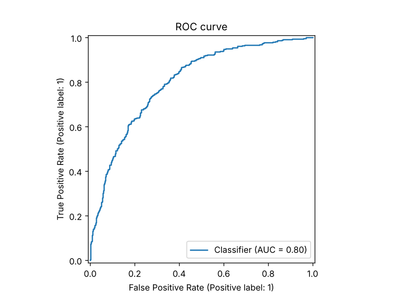
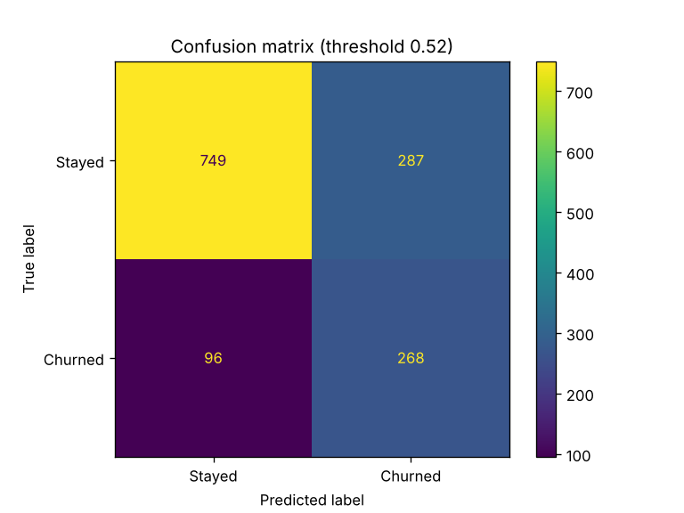
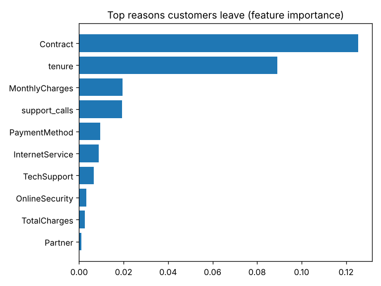

<h1 align="center">Customer Churn Prediction using Cloud Machine Learning</h1>

<p align="center">
An end-to-end machine learning project that finds telecom customers who are likely to leave,
decides who to contact based on <b>profit</b>, and serves predictions through a web API on Google Cloud.
</p>

<p align="center">
  
  
  
  
  
</p>

---

## Table of Contents
1. [What is churn?](#what-is-churn)
2. [Problem statement](#problem-statement)
3. [Project highlights](#project-highlights)
4. [Architecture](#architecture)
5. [Project structure](#project-structure)
6. [Results](#results)
7. [Run locally](#run-locally)
8. [Run on Google Cloud](#run-on-google-cloud)
9. [API usage](#api-usage)
10. [Business insights](#business-insights)
11. [Limitations](#limitations)
12. [Future improvements](#future-improvements)

## What is churn?
**Churn** means a customer stops using a company's service. Keeping an existing customer costs much less than
finding a new one, so if a company knows **who is about to leave**, it can send an offer in time.

## Problem statement
About **26% of customers** leave ConnectTel (a telecom company). The marketing team sent a discount to **everyone**,
which wasted money on people who would have stayed anyway.

**Goal:** predict who will churn, contact only the high-risk customers, and prove the campaign makes money.

## Project highlights
- Compares **Logistic Regression, Random Forest and Gradient Boosting** using 5-fold cross-validation.
- Uses a scikit-learn **Pipeline**, so training and live predictions use exactly the same cleaning steps.
- Chooses the decision **threshold by profit**, not by guesswork.
- Explains **why customers leave** with a feature-importance chart.
- **Cloud ready:** same training script runs on **Vertex AI**; the API runs on **Cloud Run** using Docker.

## Architecture
```
Customer data (CSV)
       |
       v
Cloud Storage  --->  Vertex AI Training Job  --->  model.joblib + metrics.json (Cloud Storage)
                                                          |
                                                          v
                                             FastAPI app in Docker  --->  Cloud Run
                                                          |
                                                          v
                                       CRM / website  ->  churn probability + action
```

## Project structure
```
churn_project/
├── 01_generate_data.py      # creates a 7,000-customer synthetic dataset
├── 02_train_model.py        # cleans data, trains 3 models, picks best, saves model and charts
├── 03_vertex_train_job.py   # runs the training on Google Cloud Vertex AI
├── app.py                   # FastAPI service (POST /predict)
├── Dockerfile               # container for Cloud Run
├── requirements.txt
├── data/
│   └── customer_churn.csv
└── outputs/
    ├── model.joblib
    ├── metrics.json
    ├── roc_curve.png
    ├── confusion_matrix.png
    ├── feature_importance.png
    └── top_risk_customers.csv
```

## Results
Tested on **1,400 customers the model never saw** (364 real churners).

| Model | Cross-validation ROC-AUC |
|---|---|
| **Logistic Regression** (best) | **0.796** |
| Gradient Boosting | 0.789 |
| Random Forest | 0.782 |

| Measure (threshold 0.52) | Value |
|---|---|
| Test ROC-AUC | 0.803 |
| Accuracy | 72.6% |
| Precision | 48.3% |
| Recall | 73.6% |
| F1 score | 0.583 |

**Business impact** (assumptions: $50 per offer, 30% of contacted churners stay, $600 value per saved customer):

| Strategy | Profit |
|---|---|
| Offer to everyone | -$4,480 |
| Offer to the model's high-risk list | **+$20,490** |

<p align="center">
  
  
  
</p>

## Run locally
```bash
git clone https://github.com/iostream8/CustumerChurn-Prediction.git
cd CustumerChurn-Prediction

python -m venv .venv
source .venv/bin/activate          # Windows: .venv\Scripts\activate
pip install numpy pandas scikit-learn matplotlib joblib fastapi uvicorn "pydantic>=2"

python 01_generate_data.py         # creates data/customer_churn.csv
python 02_train_model.py           # trains and saves the model in outputs/
uvicorn app:app --reload           # API at http://127.0.0.1:8000/docs
```

## Run on Google Cloud
1. Create a Google Cloud project and enable **Vertex AI, Cloud Storage, Cloud Run, Artifact Registry, Cloud Build**.
2. Install the cloud libraries: `pip install google-cloud-aiplatform gcsfs google-cloud-storage`
3. Create a bucket and upload the data:
   ```bash
   gcloud auth application-default login
   gsutil mb -l us-central1 gs://YOUR_BUCKET
   gsutil cp data/customer_churn.csv gs://YOUR_BUCKET/data/
   ```
4. Put your project ID and bucket name in `03_vertex_train_job.py`, then run `python 03_vertex_train_job.py`.
5. Download the trained model into `outputs/`:
   ```bash
   gsutil cp gs://YOUR_BUCKET/churn-output/model/model.joblib outputs/
   gsutil cp gs://YOUR_BUCKET/churn-output/model/metrics.json outputs/
   ```
6. Deploy the API:
   ```bash
   gcloud run deploy churn-api --source . --region us-central1
   ```

> Use the **same scikit-learn version** for training and serving (it is saved in `outputs/metrics.json`).
> Delete the cloud resources when you finish so you are not charged.

## API usage
**Request**
```bash
curl -X POST http://127.0.0.1:8000/predict \
  -H "Content-Type: application/json" \
  -d '{
    "gender": "Male", "SeniorCitizen": 0, "Partner": "No", "Dependents": "No",
    "tenure": 3, "PhoneService": "Yes", "InternetService": "Fiber optic",
    "OnlineSecurity": "No", "TechSupport": "No", "Contract": "Month-to-month",
    "PaperlessBilling": "Yes", "PaymentMethod": "Electronic check",
    "MonthlyCharges": 95.0, "TotalCharges": 285.0, "support_calls": 3
  }'
```

**Response**
```json
{ "churn_probability": 0.946, "high_risk": true, "action": "Send retention offer" }
```

## Business insights
| Finding | Suggested action |
|---|---|
| Month-to-month customers churn the most (37.5% vs 7.9% for two-year) | Offer a discount to move them to a longer plan |
| Fiber optic customers churn more (35.8%) | Check speed, outage and price problems |
| Many support calls signal unhappiness | Senior agent calls after the third support call |
| Tech support and online security keep customers longer | Give these add-ons free for 3 months |
| Electronic check payers churn more | Small bonus for automatic payment |

## Limitations
- The dataset is **synthetic**, so results are an example and not real company data.
- The model shows **who** may leave, not exactly **why** one person leaves.
- Profit numbers depend on the assumptions above.
- Models drift over time, so retrain regularly and monitor performance.
- Handle customer data carefully and follow privacy rules.

## Future improvements
- Use the real Kaggle *Telco Customer Churn* dataset.
- Add **SHAP** explanations for each prediction.
- Tune with GridSearchCV or Vertex AI Hyperparameter Tuning.
- Store data in **BigQuery** and schedule predictions with **Cloud Scheduler**.
- Build a dashboard with Streamlit or Looker Studio.
- Add monitoring and automatic retraining (MLOps) and an A/B test with a control group.

---
<p align="center">Made by <b>iostream8</b> | If this project helped you, give it a star.</p>
